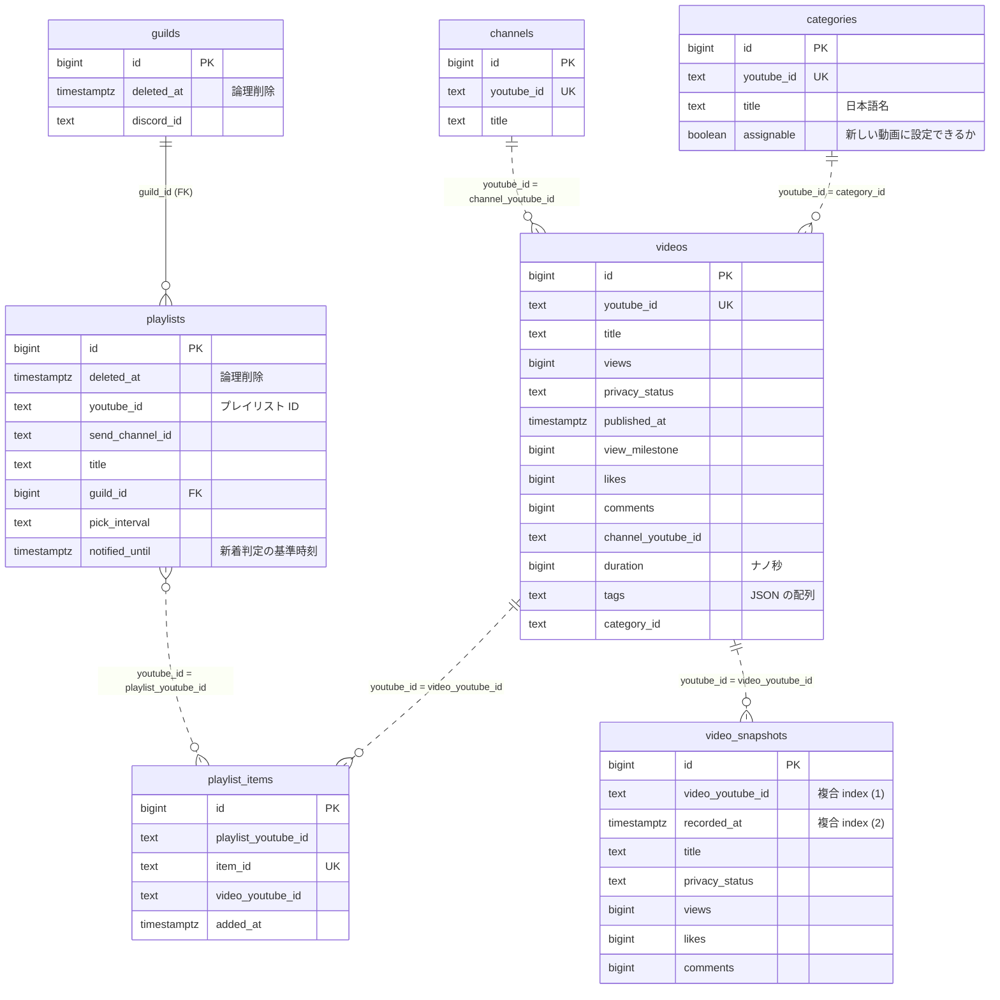
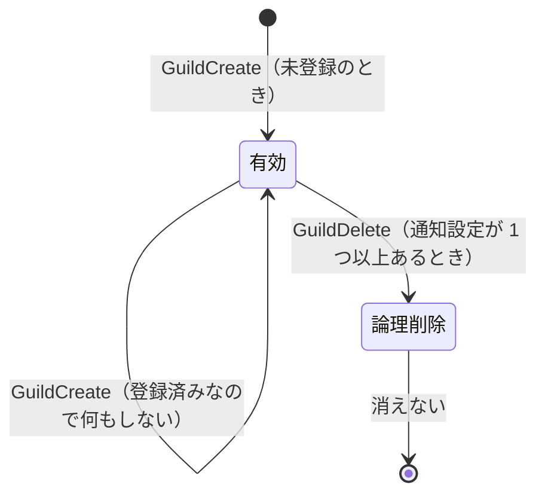
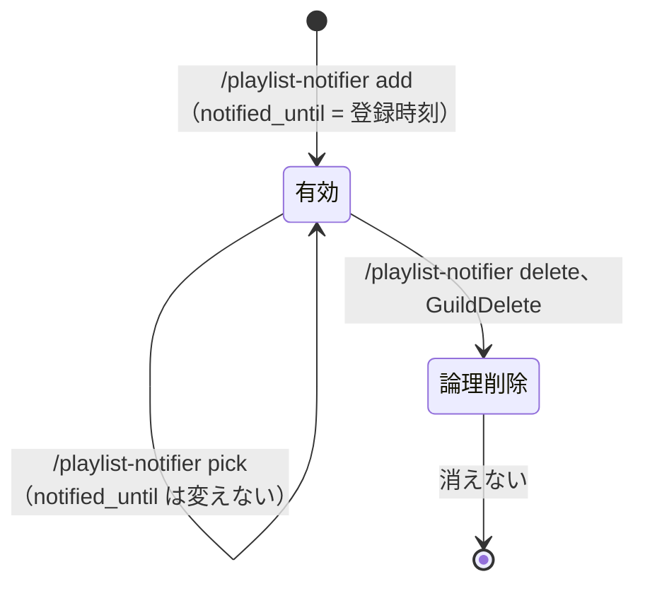
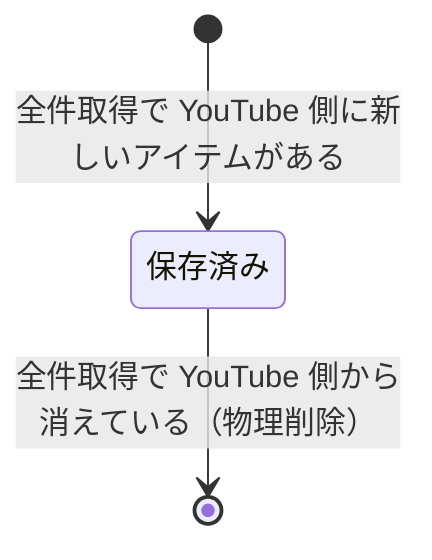
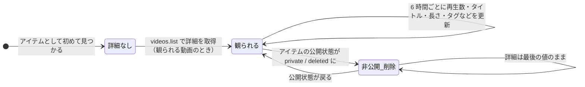

# Discord Playlist Notifier

YouTube のプレイリストを見張って、新しい動画が追加されたら Discord のチャンネルに知らせるボットです。

通知のほかに、再生数の節目のお知らせ、毎日の「今日の一本」、年末のまとめ、再生数の推移のグラフなど、
プレイリストを眺めて楽しむための機能もそろえています。

## 目次

- [できること](#できること)
- [使い方（Discord で）](#使い方discord-で)
- [動かし方（セルフホスト）](#動かし方セルフホスト)
- [トラブルシューティング](#トラブルシューティング)
- [外部から使う：MCP サーバー](#外部から使うmcp-サーバー)
- [開発](#開発)
- [ライセンス](#ライセンス)

## できること

### 自動で届く通知

| 通知 | タイミング | 内容 |
|---|---|---|
| 新しい動画 | 5 分ごとに確認 | プレイリストに追加された動画を 1 本ずつ投稿します |
| 非公開・削除 | 5 分ごとに確認 | 観られた動画が非公開・削除になったら知らせます |
| 再生数の節目 | 6 時間ごとに確認 | 再生数が 10 万・100 万・1000 万・1 億回を越えたら知らせます |
| 今日の一本 | 毎日 12:00（設定したときだけ） | プレイリストからランダムに選んだ 1 本を投稿します。毎週（月曜）・毎月（1 日）にもできます |
| 年間のまとめ | 12/31 21:00 | その年に追加した動画の数、一番追加した月、再生数ランキングなどを投稿します |

### コマンドで見られるもの

- プレイリストの統計（動画数、追加のペース、再生数ランキング、月ごとの追加数）
- 最近再生数が伸びている動画と、その推移のグラフ
- 1 本の動画の再生数・高評価数の推移のグラフ
- ランダムに選んだ動画、1 年間のまとめ

## 使い方（Discord で）

ボットをサーバーに招待すると、`/playlist-notifier` というスラッシュコマンドが使えるようになります。

### はじめる：プレイリストを登録する

1. 通知を受け取りたいテキストチャンネルを開きます。
2. YouTube でプレイリストを開き、URL の `list=` の後ろにある ID をコピーします。
   - 例: `https://www.youtube.com/playlist?list=PLexample123` なら `PLexample123`
3. そのチャンネルで `/playlist-notifier add playlist-id:PLexample123` を実行します。

これで、登録した**後に**追加された動画が、このチャンネルに届くようになります。
登録する前からプレイリストに入っていた動画は通知しません。

### コマンド一覧

すべて `/playlist-notifier` のサブコマンドです。

| コマンド | 内容 | 引数 |
|---|---|---|
| `add` | プレイリストを登録し、実行したチャンネルに通知します | `playlist-id` |
| `delete` | プレイリストの登録を外します | `playlist-id` |
| `list` | このサーバーで登録しているプレイリストの一覧 | なし |
| `pick` | 「今日の一本」を投稿する間隔を決めます | `playlist-id`、`interval` |
| `summary` | プレイリストの統計 | `playlist-id`（省略可） |
| `trending` | 再生数が伸びた動画のランキングとグラフ | `playlist-id`（省略可）、`days`（省略可） |
| `history` | 1 本の動画の再生数・高評価数のグラフ | `video`、`days`（省略可） |
| `random` | ランダムに動画を選びます | `count`（省略可） |
| `wrapped` | 1 年間のまとめ | `year`（省略可） |
| `source` | このボットのソースコード（GitHub）へのリンク | なし |

`playlist-id` を省略できるコマンドは、省略するとこのサーバーで登録しているプレイリストすべてを表示します。

### 各コマンドの詳細

#### `add` / `delete` / `list`

- `add` は、YouTube でプレイリストが見つかることを確かめてから登録します。同じサーバーに同じプレイリストは 1 つしか登録できません。
- 通知先は `add` を実行したチャンネルです。通知先を変えたいときは、`delete` してから別のチャンネルで `add` し直してください。

#### `pick`

- `interval` は「毎日」「毎週（月曜）」「毎月（1 日）」「やめる」から選びます。投稿はどれも 12:00 です。
- 登録したプレイリストごとに設定できます。

#### `summary`

動画数（観られる・非公開・削除の内訳）、追加のペース、再生数ランキング（累計の上位 3 本）、直近 6 か月の月ごとの追加数を表示します。

#### `trending`

- 期間中に再生数が伸びた上位 3 本と、その伸びの推移をグラフで表示します。グラフはプレイリストごとに 1 枚です。
- `days` はさかのぼる日数です（1〜365、省略すると 30）。
- 伸びは、期間中の最初の記録から最新の記録までの再生数の差です。記録が期間より短いときは、記録のある範囲（例: 10/13〜10/15）で比べ、その範囲を表示します。

#### `history`

- `video` には動画の URL か ID を渡します。`youtube.com/watch?v=`、`youtu.be/`、`music.youtube.com`、`shorts/` の URL に対応しています。
- 登録しているプレイリストに入っている動画だけが対象です。
- `days` はさかのぼる日数です（1〜365、省略すると 30）。

#### `random` / `wrapped`

- `random` の `count` は選ぶ本数です（1〜5、省略すると 1）。
- `wrapped` の `year` はまとめる年です（省略すると今年）。

### 知っておきたいこと

- **登録前の動画は通知しません。** 登録した時刻より後にプレイリストへ追加された動画だけが対象です。
- **同じ動画を外して入れ直すと、もう一度通知します。** YouTube 上では別の追加として扱われるためです。
- **通知が届かないことがまれにあります。** 二重に送らないことを優先しているため、Discord への送信に失敗した通知は送り直しません。
- **グラフは使い始めてすぐには出ません。** 再生数などは 6 時間ごとに記録しているので、`trending` と `history` は記録が 2 回分たまるまで待つ必要があります。
- **非公開・削除になった動画は、統計やランキングには出ません。** 数（内訳）にだけ含めます。

## 動かし方（セルフホスト）

### 必要なもの

- [Docker](https://www.docker.com/) と [Docker Compose](https://docs.docker.com/compose/)
- Discord のボットトークン（[Discord Developer Portal](https://discord.com/developers/applications) で取得）
- YouTube Data API v3 の API キー（[Google Cloud Console](https://console.cloud.google.com/) で取得）

### セットアップ

1. リポジトリをクローンします。

   ```bash
   git clone https://github.com/tabo-syu/discord-playlist-notifier.git
   cd discord-playlist-notifier
   ```

2. 設定ファイルを作り、値を書き込みます（次の「環境変数」を参照）。

   ```bash
   cp .env.example .env
   ```

3. 起動します。PostgreSQL・マイグレーション・ボット・MCP サーバー・バックアップがまとめて立ち上がります
   （マイグレーションが終わってから、ボットと MCP サーバーが起動します）。

   ```bash
   docker compose up -d
   docker compose logs -f bot mcp   # ログを見る
   ```

4. Discord Developer Portal の OAuth2 URL Generator で招待 URL を作り、ボットをサーバーに招待します。
   - スコープ: `bot`、`applications.commands`
   - ボットの権限: `Send Messages`、`Embed Links`、`Attach Files`（グラフの画像を送るため）

スラッシュコマンドはボットが起動している間だけ、サーバーごとに登録されます。ボットを止めるとコマンドも消えます。

### 環境変数

`.env` に書きます。ボット本体は `.env` を読まず、`docker compose` が読んで渡します。

| 変数 | 説明 | 例 |
|---|---|---|
| `DB_HOST` | PostgreSQL のホスト | `db` |
| `DB_PORT` | PostgreSQL のポート | `5432` |
| `DB_NAME` | データベース名 | |
| `DB_USER` | ユーザー名 | |
| `DB_PASSWORD` | パスワード | |
| `DB_TIMEZONE` | タイムゾーン。日付の表示や定期投稿の時刻にも使います | `Asia/Tokyo` |
| `DISCORD_ACCESS_TOKEN` | Discord のボットトークン | |
| `YOUTUBE_APIKEY` | YouTube Data API v3 の API キー | |

MCP サーバーの待ち受けアドレス `MCP_ADDR` は `docker-compose.yml` の `mcp` で `:8080` に設定しています。

### バックアップ

`backup` コンテナが起動時と、その後 24 時間ごとに `pg_dump` を実行し、`backups/` に
`20261020-030000.dump` のような名前で保存します。14 日より古いファイルは消します。
バックアップは同じマシンにしか残らないので、ディスクの故障に備えるなら別の場所にもコピーしてください。

```bash
docker compose logs backup   # Backup created: ... が出ていれば成功
ls backups/
```

復元するときは、ボットと MCP サーバーを止めてから `pg_restore` を実行します。

```bash
docker compose stop bot mcp
set -a && . ./.env && set +a
docker compose exec -T db pg_restore -U "$DB_USER" -d "$DB_NAME" --clean --if-exists < backups/20261020-030000.dump
docker compose start bot mcp
```

### YouTube API のクォータ

YouTube Data API には 1 日 10,000 ユニットの上限があります。このボットは次のように節約しているので、
プレイリストが数個〜数十個なら上限には届きません。

- 5 分ごとの確認では、まずプレイリストのアイテム数だけを見ます（50 個で 1 ユニット）。
  中身を全部取り直すのは、アイテム数が変わったときと 1 時間ごとだけです。
- 動画の詳細は、まだ持っていない動画の分だけ取ります。再生数の更新は 6 時間ごとです（50 本で 1 ユニット）。
- コマンドの統計やグラフ、MCP サーバーは DB に保存した内容だけを使い、API を呼びません。

## トラブルシューティング

### ボットがコマンドに応答しない・コマンドが出てこない

- ボットが起動しているか確認してください（`docker compose ps`）。コマンドは起動中しか存在しません。
- 招待のときに `applications.commands` のスコープを付けたか確認してください。
- `.env` の `DISCORD_ACCESS_TOKEN` が正しいか確認してください。

### 通知が届かない

- プレイリストが公開（または限定公開）になっているか確認してください。非公開のプレイリストは読めません。
- 登録より前に追加された動画は通知しません（[知っておきたいこと](#知っておきたいこと)）。
- ボットにそのチャンネルへの投稿権限があるか確認してください。
- YouTube API キーが有効で、YouTube Data API v3 が有効になっているか確認してください。
- ログ（`docker compose logs bot`）にエラーが出ていないか確認してください。

プレイリストが 1 つも登録されていない間は、ログに 5 分ごと `Could not notify cause: playlist is not subscribed` が出ます。これはエラーではありません。

### データベースにつながらない

- `db` コンテナが起動しているか確認してください。
- `.env` の `DB_*` の値が正しいか確認してください。

## 外部から使う：MCP サーバー

ほかのボット（Claude Code など）から、登録されているプレイリストの中身を調べられるように、
読み取り専用の MCP サーバーを用意しています。ボットとは別のコンテナ（`mcp`）で動き、
`docker compose` で起動すると、Docker の `playlist-api` ネットワーク上の `http://playlist-notifier:8080/mcp` で待ち受けます
（ホストにはポートを公開しません。認証はないので、公開範囲を広げるときは注意してください）。

| ツール | 内容 |
|---|---|
| `list_playlists` | 登録されているプレイリストの一覧と動画数 |
| `find_videos` | タイトル・チャンネル名・タグ・カテゴリ・動画の長さ・追加された期間で動画を探す（新しい順・古い順・再生数順） |
| `playlist_stats` | プレイリストの統計（`/playlist-notifier summary` と同じ内容） |
| `playlist_wrapped` | 1 年間のまとめ（`/playlist-notifier wrapped` と同じ内容） |
| `random_videos` | ランダムに動画を選ぶ |
| `video_history` | 動画のタイトル・公開状態・再生数・高評価数・コメント数の推移（6 時間ごとの記録） |

使う側は `playlist-api` ネットワークに参加し、MCP の設定に次のように書きます。

```json
{ "mcpServers": { "playlist": { "type": "http", "url": "http://playlist-notifier:8080/mcp" } } }
```

## 開発

コードの書き方やテストの方針など、詳しいことは [CLAUDE.md](CLAUDE.md) にまとめています。

### 開発環境

- Go 1.27 以上
- Docker（DB のテストで PostgreSQL を立てるため）

よく使うコマンドは [Taskfile.yml](Taskfile.yml) にまとめていて、`go tool task` で呼べます（別にインストールは要りません）。

```bash
go tool task hooks       # Git フックを入れる（clone したら 1 回だけ）
go tool task fmt         # 整形
go tool task lint        # 静的チェック
go tool task test        # テスト（Docker が必要）
go tool task test:short  # DB のテストを飛ばす（Docker なし）
go tool task check       # build・tidy・lint・test をまとめて。コミット前はこれ
```

Docker の外で直接動かすときは、PostgreSQL を用意し、環境変数をシェルにエクスポートしてから実行します。
ボットと MCP サーバーはスキーマを作らないので、先にマイグレーションを実行します。

```bash
go run cmd/migrate/main.go   # スキーマを更新して終わる
go run cmd/bot/main.go
go run cmd/mcp/main.go       # MCP サーバー（MCP_ADDR も必要）
```

### プロジェクトの構成

DDD のレイヤードアーキテクチャで、依存は外側から内側への一方向です。

```
cmd/
├── bot/               ボットのエントリーポイント（依存の組み立て）
├── mcp/               MCP サーバーのエントリーポイント
└── migrate/           スキーマを更新して終了する
internal/
├── presentation/      Discord のコマンド、定期実行、通知の投稿、MCP サーバー、文言の整形
├── infrastructure/    DB（GORM）と YouTube Data API の実装
├── application/       ユースケース
└── domain/            ドメインモデル
    ├── guild/         ボットが参加しているサーバー
    ├── subscription/  サーバーごとのプレイリストの通知設定
    ├── library/       プレイリストの中身（アイテムと動画）。全サーバーで共有
    └── notification/  どのチャンネルに何を通知するかを決める
```

### データのライフサイクル

DB の各テーブルの行が、いつ作られ、いつ更新され、いつ消えるかをまとめます。

#### 全体像

テーブルは役割で 2 つに分かれます。

- **サーバーごとの設定**（`guilds`、`playlists`）: Discord のイベントとスラッシュコマンドで変わる
- **プレイリストの中身**（`playlist_items`、`videos`、`channels`、`categories`、`video_snapshots`）: YouTube から取ってきたもの。全サーバーで共有し、定期実行で変わる



実線は外部キー、点線は YouTube の ID で結び付けている関係（外部キーなし）です。
`playlists` テーブルは、コード上は `subscription.Subscription`（サーバーごとの通知設定）です。

##### 誰がいつ書き込むか

| きっかけ | 間隔 | `guilds` | `playlists` | `playlist_items` | `videos` |
|---|---|---|---|---|---|
| ボットがサーバーに参加・再接続（`GuildCreate`） | イベント | 作成 | | | |
| ボットがサーバーから外れる（`GuildDelete`） | イベント | 論理削除 | 論理削除 | | |
| `/playlist-notifier add` | コマンド | | 作成 | | |
| `/playlist-notifier delete` | コマンド | | 論理削除 | | |
| `/playlist-notifier pick` | コマンド | | `pick_interval` を更新 | | |
| `NotifyUpdates`（新着の通知） | 5 分 | | `notified_until`・`title` を更新 | 追加・物理削除 | 作成・公開状態と詳細を更新 |
| `RefreshVideos`（再生数の更新） | 6 時間 | | | | 詳細・節目を更新（`video_snapshots` に追記） |
| `PostPicks` / `PostWrapped` | 毎日 / 年末 | | | | （読むだけ） |
| `RefreshCategories`（カテゴリ名の更新） | 起動時と 1 日 | | | | （`categories` を上書き） |

物理削除するのは `playlist_items` だけです。`guilds` と `playlists` は論理削除（`deleted_at`）、`videos` と `video_snapshots` は削除しません。

#### `guilds` — ボットが参加しているサーバー



- **作成**: `GuildCreate` のたびに、未登録なら 1 行作ります。`GuildCreate` は再接続のたびに届くので、ほとんどは「登録済み」で終わります。
- **削除**: `GuildDelete` で、そのサーバーの通知設定と一緒に論理削除します。通知設定を先に消すので、途中で失敗しても、退出したサーバーの通知設定だけが残ることはありません。
  - そのサーバーに通知設定が 1 つもないと、途中で return して**削除されません**（既知の挙動）。
- **再参加**: 論理削除された行は「未登録」とみなすので、新しい行が作られます。古い行は残り続けます。

#### `playlists` — サーバーごとの通知設定



- **作成**: `add` で、YouTube でプレイリストの存在とタイトルを確かめてから作ります。同じサーバーに同じプレイリストは 1 つだけで、`playlists` の一意のインデックス（`guild_id` と `youtube_id`、論理削除した行を除く）が守るので、同時に登録しても重複しません。
- **`notified_until` は新着判定の基準時刻**です。プレイリストへの追加時刻（`playlist_items.added_at`）がこれ以降のアイテムを新着とみなします。
  - 登録した時点が基準になるので、**登録前からあった動画は通知しません**。
  - 新着を通知するとき、Discord に送る**前に**現在時刻へ進めます。送信に失敗すると通知は失われますが、二重には送りません。
  - `updated_at` は GORM が保存のたびに書き換える監査用の時刻で、新着の判定には使いません（以前は `updated_at` が基準時刻でした。`cmd/migrate` が、`notified_until` が空の行を `updated_at` で埋めます）。
  - 手で過去に戻すと、その時刻以降の動画を再通知できます。
- **削除**: 論理削除です。プレイリストの中身（`playlist_items`、`videos`）は他のサーバーと共有しているので消しません。

#### `playlist_items` — プレイリストの各アイテム



- 5 分ごとの `NotifyUpdates` が、どこかのサーバーが登録しているプレイリストを同期します（`LibraryService.Sync`）。
- **全件取得**は、次のどちらかのときだけ行います。それ以外は保存済みのアイテムをそのまま使います。
  - YouTube 上のアイテム数が前回と変わった
  - 前回の全件取得から 1 時間（`FULL_SYNC_INTERVAL`）経った
- 全件取得の結果と保存済みのアイテムを `item_id` で突き合わせ、増えたものを追加し、消えたものを**物理削除**します（`library.Playlist.Reconcile`）。
- 同じ動画をいったん外して入れ直すと、YouTube 上で別のアイテム（別の `item_id`、新しい `added_at`）になるので、新しい行として追加され、新着として通知されます。
- 「いつ全件取得したか」はメモリ上にしかないので、**再起動直後は全件取得**します。
- 全サーバーで登録が外れたプレイリストは同期されなくなり、そのアイテムは最後の状態のまま残ります。

#### `videos` — 動画ごとの最新の情報

動画 1 本につき 1 行で、複数のプレイリストに入っていても共有します。



- **作成**: いずれかのプレイリストのアイテムとして初めて見つかったときに作ります。この時点では ID と公開状態だけです。
- **詳細**（タイトル、再生数、投稿日時）は、観られる動画（公開・限定公開）の分だけ `videos.list` で取ります。
  - 詳細を初めて取ったとき、`view_milestone` に今の再生数の節目を入れます。登録前から達していた節目は通知しません。
  - 最初から非公開・削除の動画は詳細を取れないので、`title` が空のまま残ります。ユーザーには見せません（`Available()` が偽）。
- **公開状態**は、`videos.list` ではなくプレイリストのアイテム（`status.privacyStatus`）から取ります。`videos.list` は非公開・削除済みの動画を返さないためです。全件取得のたびに更新します。
  - 観られる状態から非公開・削除になったら、その動画を含むプレイリストを登録している各チャンネルに通知します。
- **再生数などの更新**: 6 時間ごとの `RefreshVideos` が、`playlist_items` に入っていて観られる動画すべてについて、タイトル・再生数・投稿日時を上書きします（50 件で 1 ユニット）。
  - 再生数が新しい節目（10 万・100 万・1000 万・1 億回）を越えたら `view_milestone` を進めて通知します。
  - `playlist_items` に入っている動画が対象なので、**全サーバーで登録が外れたプレイリストの動画も更新し続けます**。
- **削除**: しません。非公開・削除になっても、どのプレイリストから外れても、最後に分かっている詳細を残します。

##### `channels` — 動画を投稿したチャンネル

- **作成・更新**: `videos.list` で動画の詳細を取るたびに（新しい動画の取得と、6 時間ごとの `RefreshVideos`）、その動画のチャンネルを作るか、名前を上書きします。名前は同じ `videos.list` の結果から取るので、クォータは増えません。
  - 保存に失敗してもログを出すだけで、同期や通知は続けます。
- **読み出し**: MCP の `find_videos` が、チャンネル名での絞り込みと、結果のチャンネル名に使います。
- **削除**: しません。アイコンは保存しません（通知の直前に取ります）。

##### `categories` — 動画のカテゴリ

- **作成・更新**: 起動時と 1 日ごとに、`videoCategories.list`（日本・日本語、1 ユニット）の結果で上書きします。カテゴリは地域ごとに違うので、固定の一覧は持ちません。
  - 設定できない古いカテゴリ（`assignable` が偽）も保存します。古い動画に付いていることがあるためです。
- **読み出し**: MCP の `find_videos` が、カテゴリ名での絞り込みと、結果のカテゴリ名に使います。
- **削除**: しません。

##### `video_snapshots` — 動画の状態の履歴

- **追記**: 6 時間ごとの `RefreshVideos` が `videos` を更新したあと、更新した全動画の状態（タイトル・公開状態・再生数・高評価数・コメント数）を、同じ `recorded_at` で 1 行ずつ追記します。値は同じ `videos.list` の結果から取るので、クォータは増えません。
  - 対象は `videos` の更新と同じで、観られる動画だけです。非公開・削除になっている間は記録しません。
  - 高評価数やコメント数は、投稿者が非表示・無効にしていると 0 になります。
  - 記録に失敗してもログを出すだけで、節目の通知は続けます。
- **読み出し**: `/playlist-notifier history` と MCP の `video_history` が、動画ごとに期間を区切って読みます。`/playlist-notifier trending` は、プレイリストの全動画について期間中の最初と最新の記録を読んで伸びを比べ、上位の動画の記録を読みます。
- **更新・削除**: しません。1 年で約 220 万行（300〜500 MB 程度）増える見込みです。

#### 保存しないもの

| もの | どうしているか |
|---|---|
| 投稿者のアイコン | 通知を送る直前に YouTube から取る。失敗したら投稿者なしで送る（チャンネル名は検索用に `channels` にも保存する） |
| 通知の直前の再生数 | 同上（DB の値より新しい） |
| サムネイル | 動画 ID から URL を作れる |
| 全件取得の状態（アイテム数・時刻） | メモリ上だけ。再起動で消える |
| 通知した動画の履歴 | 持たない。`playlists.notified_until` との比較だけで新着を判定する |

#### 消えずに増え続けるもの

いまのところ、古いデータを掃除する処理はありません。

- 論理削除された `guilds` と `playlists` の行
- どのプレイリストからも外れた `videos` の行
- `video_snapshots` の行（6 時間ごとに動画の数だけ増える）
- 全サーバーで登録が外れたプレイリストの `playlist_items`（と、その動画の 6 時間ごとの更新）

どれも 1 行が小さく数も少ないので、現状は問題になっていません。

## ライセンス

[LICENSE](LICENSE) を参照してください。
