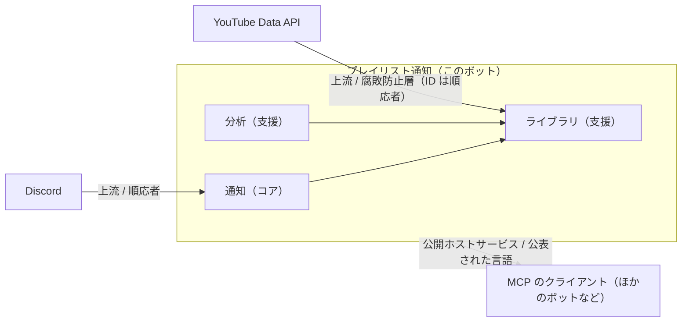
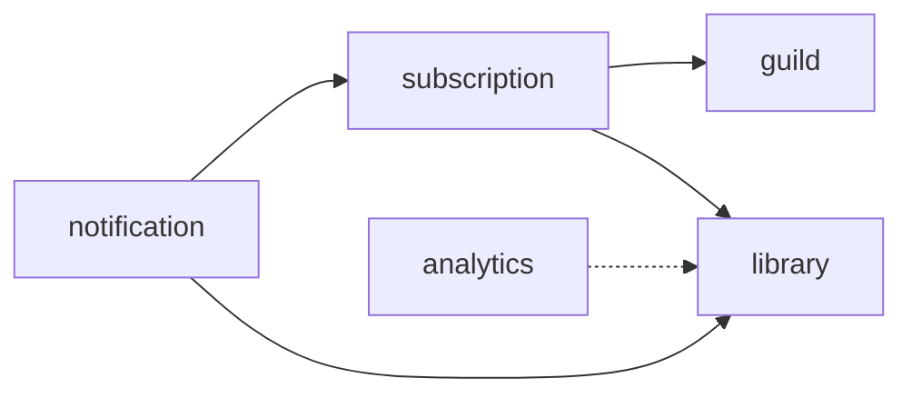

# コンテキストマップ

このボットのモデルがどこまで同じ意味を保つか（境界づけられたコンテキスト）と、外のシステムとの
関係をまとめます。言葉の意味は [用語集](glossary.md) にあります。分け方を決めた経緯は
[issue #76 の設計コメント](https://github.com/tabo-syu/discord-playlist-notifier/issues/76#issuecomment-6276539290) にあります。

## 境界づけられたコンテキストは 1 つ

ボット全体（このリポジトリ）を 1 つの境界づけられたコンテキストとします。中には性格の違う
サブドメインが 3 つありますが、コンテキストには分けず、Go のパッケージ（モジュール）で分けます。

- 作る人は 1 人で、DB もデプロイの単位も 1 つです。コンテキストを分ける理由（チームが違う、
  同じ言葉が違う意味で使われていて名前では解けない、別々にリリースしたい）がありません。
- 通知とライブラリは意図して密につながっています（`Subscription.TakeNewVideos` が同期の結果を
  直接受け取るなど）。コンテキストに分けて間で翻訳しても、同じ値を写し替えるだけになります。
- コンテキストが 1 つなので、**1 つの言葉は 1 つの意味**にします。2 つの意味を持ってしまった
  言葉（「チャンネル」「スナップショット」）は、名前を変えて分けます（[用語集](glossary.md#名前の揺れの直し方)）。

ボット（`cmd/bot`）と MCP サーバー（`cmd/mcp`）は別のプロセスですが、同じモデルと同じ DB を使う
同じコンテキストです。プロセスの数とコンテキストの数は別のものです。

## 外のシステムとの関係

矢印は上流から下流への向き（上流のモデルが下流に影響する向き）です。サブドメインの間の矢印は
パッケージの依存の向き（使う側 → 使われる側）です。

| 相手 | 向き | 関係 | どこで | 内容 |
|---|---|---|---|---|
| YouTube Data API | 上流 | 腐敗防止層 | `infrastructure/youtube`（`library.Source` と `application.LiveVideoSource` を実装） | API の応答を、ドメインの値（`PlaylistMeta`・`FetchedItem`・`VideoDetails`）に翻訳して返し、動画やチャンネルのエンティティは作らない。`Category` だけは、YouTube のデータを写すだけでこのボットが持つ状態がない参照データなので、そのまま作って返す。通知の直前に取る表示用の値（チャンネルの名前とアイコン、最新の再生数）はドメインではなく `application.LiveVideoSource` で取る（#75） |
| 〃 | 〃 | 順応者 | `library.PlaylistID`・`VideoID`・`ChannelID`・`CategoryID`・`ItemID` | ID は YouTube が発行したものをそのまま識別子に使う。このボットにとっても「YouTube の ID」が自然な言葉だから（#75） |
| Discord | 上流 | 順応者 | `presentation/discord`・`presentation/notifier`、`guild.DiscordID`・`subscription.ChannelID` | ギルド・テキストチャンネル・スラッシュコマンドという Discord の概念をそのまま言葉にする。`discordgo` の型は presentation の外に出さず、ID だけを値オブジェクトにして渡す |
| MCP のクライアント | 下流 | 公開ホストサービス・公表された言語 | `presentation/mcpserver` | 読み取り専用のツール（`list_playlists` など）を公開する。入出力は snake_case の JSON で、`mcpserver` の型（`videoOut` など）が持つ。ドメインの名前を変えても出力は変わらない |

PostgreSQL は外のコンテキストではなく、このコンテキストの中の技術的な部品（`infrastructure/persistence`）です。

## サブドメインとパッケージ

| サブドメイン | 種類 | ドメインのパッケージ | アプリケーション | 外側 |
|---|---|---|---|---|
| 通知：どの動画を、どのテキストチャンネルに、いつ知らせるか | コア | `domain/guild`・`domain/subscription`・`domain/notification` | `GuildService`・`SubscriptionService`・`NotificationService`・`NotificationHandlers`・`Notifier`（出力ポート） | `presentation/discord`・`presentation/scheduler`・`presentation/notifier` |
| ライブラリ：通知対象のプレイリストの写しを YouTube に合わせて保つ | 支援 | `domain/library` | `LibraryService` の `Sync`・`RefreshVideos`・`RefreshCategories` | `infrastructure/youtube`・`infrastructure/persistence` |
| 分析：写しを集計して見せる | 支援 | 今は `domain/library` の中（`Stats`・`Wrapped`・`Trending`・`VideoHistory`）。#93 で `domain/analytics` に分ける | `QueryService`、`LibraryService` の読み取りのメソッド。#94 で `QueryService` にまとめる | `presentation/mcpserver`・`presentation/view`、Discord の `summary`・`trending`・`history`・`wrapped` |

コアを通知にしたのは、このボットが「プレイリストに追加されたら知らせる」ためにあり、写しも分析も
そのために（またはそのついでに）あるからです。

ドメインのパッケージの依存は次のとおりで、循環しません（`analytics` は #93 の後の形）。

`library` はどのドメインのパッケージにも依存しません。ライブラリは通知を知らず、起きたことは
ドメインイベント（`VideoHidden`・`MilestoneReached`・`PlaylistSynced`）で知らせます（#73・#74）。

### 読み取りと書き込み

分析は CQRS の読み取り側にあたりますが、取り入れるのは「コマンドとクエリでサービスを分ける」
ところまでです（#94）。読み取り用のデータ（集計用のテーブルなど）は作らず、書き込みと同じモデルを
`library.Catalog` とリポジトリで読みます。読み取るのは友達のサーバーのコマンドと MCP だけで、
今の速さで困っていないためです。

## 将来コンテキストを分けるなら

ライブラリをほかのボットにも使わせる、といった理由で分けることになったら、分け目は
`library` と通知（`subscription`・`notification`）の間です。今そこを越えているものは次のとおりで、
分けるときはこれらを翻訳するか、公表された言語として固定することになります。

- プレイリストの ID（`library.PlaylistID`）。通知設定が参照している
- 同期したプレイリスト（`library.Snapshot`、#92 で `SyncedPlaylist`）と、それを運ぶイベント `PlaylistSynced`
- 動画のイベント（`VideoHidden`・`MilestoneReached`）と、通知の Embed に出す動画（`library.Video`）
- 「動画を含むプレイリスト」（`Catalog.PlaylistsContaining`）と、中身（`PlaylistVideo`）
